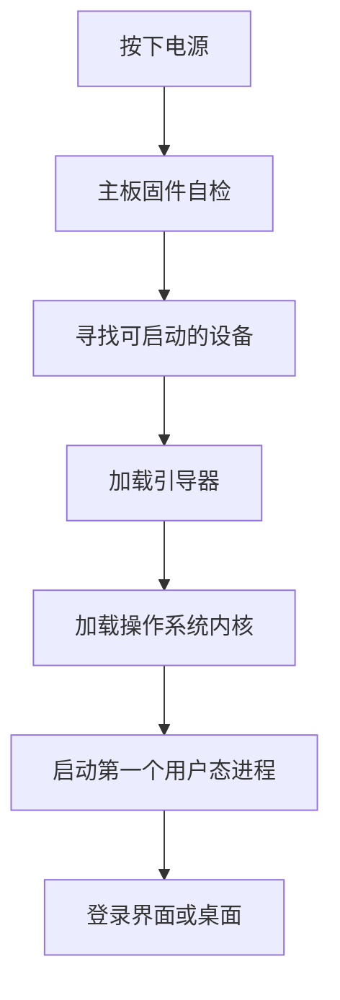

# 0.1 计算机里有什么

先从一个很具体的问题开始：

> 你按下电源键，几秒钟后看到登录界面。这中间发生了什么？

要回答这个问题，不需要懂电子电路，也不需要懂操作系统内核。先认识几个部件，知道它们各自负责什么就够了。

## 0.1.1 一台计算机的五个部分

从写程序的角度看，一台计算机可以粗略分成五部分：

| 部件 | 主要职责 | 你可以把它想成 |
|------|----------|----------------|
| CPU | 执行指令，做运算和判断 | 厨房里的厨师 |
| 内存 | 临时存放正在运行的程序和数据 | 厨师面前的案板 |
| 硬盘或 SSD | 长期存放文件 | 冰箱和储物柜 |
| 主板与总线 | 连接各个部件，传递数据和命令 | 厨房的台面和通道 |
| 输入输出设备 | 键盘、鼠标、屏幕、网卡等 | 取菜窗口和传菜口 |

这些部件里，初学阶段最需要分清的是内存和硬盘。

### 内存和硬盘的区别

| 对比项 | 内存 | 硬盘或 SSD |
|--------|------|------------|
| 断电后数据 | 消失 | 保留 |
| 速度 | 很快 | 慢得多 |
| 容量 | 通常较小，如 8GB、16GB | 通常较大，如 256GB、1TB |
| 存放内容 | 正在运行的程序和数据 | 文件、照片、代码、操作系统 |
| 价格 | 每 GB 更贵 | 每 GB 更便宜 |

可以用一个日常场景理解：

- 硬盘是冰箱，东西可以长期放在里面。
- 内存是案板，做菜时把要用的材料拿出来放在上面。
- CPU 是厨师，按照菜谱一步步操作。

程序运行时，操作系统会把需要的指令和数据从硬盘加载到内存，CPU 再从内存里取指令执行。CPU 不能直接拿硬盘里的文件当变量用。

### CPU 在做什么

CPU 的工作可以粗略概括成一个循环：

1. 取指令：从内存里读出一条指令。
2. 译码：弄清楚这条指令要做什么。
3. 执行：做运算、读写内存或跳转到别的位置。
4. 写下一条指令的位置，继续循环。

现代 CPU 会一次处理多条指令，也有多级缓存、多个核心，但初学阶段先记住这个基本循环就够了。

CPU 还有几个常见参数：

- 位数：32 位或 64 位，影响一次能处理的地址范围。
- 核心数：可以简单理解为能同时干活的“厨师数量”。
- 主频：每秒的时钟周期数，但不能直接拿来比较不同架构 CPU 的快慢。
- 缓存：CPU 内部的小容量高速存储，用来减少访问内存的等待。

### 主板、总线和输入输出

主板把 CPU、内存、硬盘和各种设备连接起来。总线负责在这些部件之间传数据。

输入输出设备负责和外界交互：

- 键盘、鼠标：输入。
- 屏幕、打印机：输出。
- 网卡：既输入也输出。
- 硬盘：从 CPU 的角度看，也属于一种输入输出设备。

## 0.1.2 开机时发生了什么

开机流程可以简化成下面这样：

几个名词的解释：

- 固件：主板上的一段程序，常见的是 BIOS 或 UEFI。它负责最基本的硬件检查和启动。
- 引导器：负责找到并加载操作系统内核，例如 Linux 常见的 GRUB，Windows 的启动管理器。
- 内核：操作系统的核心，负责管理 CPU、内存、文件和设备。
- 第一个用户态进程：Linux 上常见的是 `init` 或 `systemd`，它再启动登录服务、桌面环境等。

不同系统的细节不一样，但大致顺序相同：固件 → 引导器 → 内核 → 用户态程序 → 桌面。

这里不展开 UEFI、Secure Boot、分区表等细节。你现在只需要知道：**操作系统也是被一段一段加载起来的，不是一按电源就凭空出现。**

## 0.1.3 这些知识和 C 语言有什么关系

后面写 C 程序时，会反复遇到这几个事实：

1. 源代码是硬盘上的一个文本文件。
2. 编译器读取源代码，生成可执行文件，可执行文件也在硬盘上。
3. 运行程序时，操作系统把可执行文件加载到内存，创建进程。
4. CPU 从内存里取指令执行。
5. 指针保存的是内存地址，所以理解“内存”是理解指针的前提。

这一章不需要你立刻理解指针。只要先记住：**程序在硬盘上是一个文件，运行起来以后才变成内存里的进程。**

## 0.1.4 小结

- CPU 负责执行指令，内存临时存放运行中的程序和数据，硬盘长期存放文件。
- 内存断电会丢数据，硬盘不会。
- 开机大致经过固件、引导器、内核、用户态程序和桌面。
- 程序是文件，进程是程序运行起来以后的状态。

## 练习

1. 为什么 8GB 内存的电脑关机后，内存里的内容不会保留，而 256GB 硬盘里的文件还在？
2. 程序运行时，为什么操作系统要先把可执行文件加载到内存？
3. “CPU 主频越高，程序一定越快”这句话为什么不完全对？

参考答案

1. 内存需要持续供电才能保持数据，断电后内容丢失；硬盘或 SSD 用磁性或闪存方式长期保存数据，不需要持续供电。
2. CPU 只能从内存中取指令和数据，不能直接执行硬盘上的文件；加载到内存后，CPU 才能按地址访问指令和数据。
3. 程序速度还受核心数、缓存、内存带宽、磁盘速度、指令类型和程序本身影响。不同架构的 CPU 也不能只比主频。

---

[上一节：第 0 章导读](../README.md) · [下一节：0.2 程序怎样跑起来](<0.2 程序怎样跑起来.md>)
