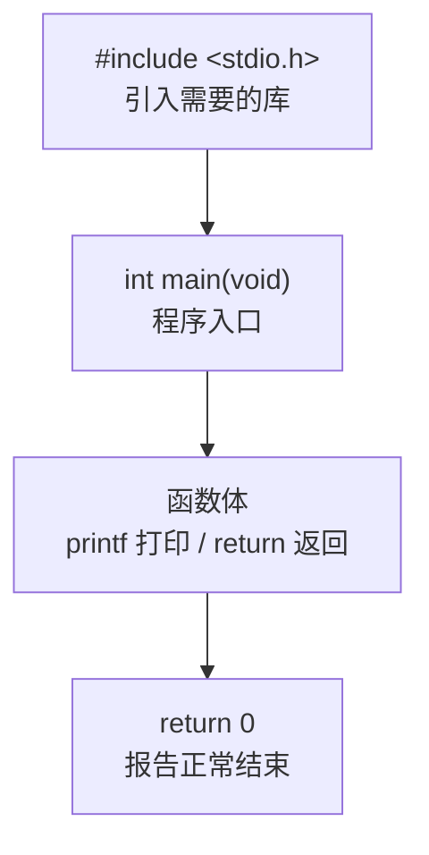

# 1.3 第一个 C 程序

这一节把上一节准备好的环境真正用起来：写出、编译并运行你的第一个 C 程序，然后逐行弄懂它，再看程序出错时会发生什么。

## 1.3.1 写出 hello.c

进入工作目录，创建 `hello.c`，输入以下内容（注意不要照抄注释里的空格，代码用 Tab 缩进）：

```c
// 1.3.1 hello.c
#include <stdio.h>

int main(void)
{
	printf("你好，世界\n");
	return 0;
}
```

<!-- output: 1.3.1 -->
```text
你好，世界
```

保存文件。编译它：

```bash
cc hello.c -o hello
```

这条命令的意思是：用编译器 `cc` 把 `hello.c` 翻译成可执行文件，`-o hello` 指定输出文件名叫 `hello`。命令执行完没有任何输出，通常意味着编译成功。

运行它：

```bash
./hello
```

`./` 表示"当前目录下的"。运行后，终端里会出现：

```text
你好，世界
```

> **Windows 提示**
>
> Windows 上编译命令相同（把 `cc` 换成 `gcc`）：
>
> ```bash
> gcc hello.c -o hello.exe
> .\hello.exe
> ```
>
> CMD 里输入 `hello.exe` 或 `.\hello.exe` 都可以；PowerShell 里建议用 `.\hello.exe`，因为 PowerShell 出于安全考虑不执行当前目录下不带路径前缀的命令。

`cc hello.c -o hello` 与 `gcc hello.c -o hello`、`clang hello.c -o hello` 完全等价，用哪个都行。本书统一写 `cc`。

## 1.3.2 逐行解剖

程序只有 6 行，每一行都有明确的职责。

### 第 1 行：`#include <stdio.h>`

这一行以 `#` 开头，它不是普通的 C 语句，而是预处理指令（preprocessor directive），在编译开始前由预处理器处理。`#include <stdio.h>` 的意思是：把标准输入输出头文件（standard input output header）的内容插入到这里。

`stdio.h` 里声明了 `printf`、`scanf` 等函数。不写这一行，编译器不认识 `printf` 是什么，会报错。第 0 章讲过"声明"和"定义"的区别，这里先用起来，第 2 章讲函数时再展开。

### 第 3 行：`int main(void)`

这一行声明了主函数（main function）。每个 C 程序都必须有一个 `main` 函数，它是程序的入口，操作系统加载程序后，从这里开始执行。

拆开看它的三个部分：

| 部分 | 含义 |
|------|------|
| `int` | 这个函数返回一个整数，用来报告程序结束的状态 |
| `main` | 函数名，固定写法 |
| `(void)` | 函数不接受任何参数 |

`void` 在这里表示"没有"。写 `int main(void)` 时不要省略参数列表里的 `void`，这是明确告诉编译器"这个函数没有参数"，也是本书统一采用的写法。

### 第 4 行：`printf("你好，世界\n");`

`printf` 把内容打印到屏幕，它是标准库提供的函数。看它的结构：

```c
printf("你好，世界\n");
```

- `printf`：函数名。
- `"你好，世界\n"`：参数，是一个字符串（string），双引号括起来的一段文字。
- 结尾的 `;`：语句结束符。C 语言里每条语句都以分号结尾，漏掉它是最常见的编译错误。

字符串里的 `\n` 是换行符（newline），本身不显示，作用是让后面的内容从新的一行开始。1.3.5 会专门讲它。

### 第 5 行：`return 0;`

`main` 函数返回整数 `0`。这个值会交还给操作系统，约定俗成：`0` 表示程序正常结束，非零表示出了问题。第 0 章讲进程时提到过，终端里可以用 `echo $?` 查看上一个程序的退出状态，试一试就能看到 `0`。

### 第 6 行：`}`

与 `int main(void)` 后面的 `{` 配对，标记函数体的结束。`{` 和 `}` 之间的部分叫函数体（function body），程序要做的事情都写在里面。

整体结构可以用一张图概括：



## 1.3.3 转义字符和 `\n`

`\` 开头的字符序列叫转义字符（escape sequence）。它们在字符串里有特殊含义，常用的几个：

| 写法 | 含义 |
|------|------|
| `\n` | 换行 |
| `\t` | 制表符（对齐用） |
| `\"` | 双引号本身 |
| `\\` | 反斜杠本身 |

为什么需要 `\"` 和 `\\`？因为 `"` 和 `\` 在字符串里都有特殊用途，想表示它们本身，就得转义。

一个例子：

```c
// 1.3.3 escape.c
#include <stdio.h>

int main(void)
{
	printf("第一行\n第二行\n");
	printf("姓名\t年龄\n");
	printf("张三\t20\n");
	printf("他说：\"C 语言很有用\"\n");
	printf("反斜杠本身是：\\\n");

	return 0;
}
```

<!-- output: 1.3.3 -->
```text
第一行
第二行
姓名	年龄
张三	20
他说："C 语言很有用"
反斜杠本身是：\
```

去掉 `\n` 会怎样？`printf("你好，世界")` 打印完不会换行，终端的提示符会紧贴在输出后面，看起来很乱。养成习惯：每条 `printf` 都以 `\n` 结尾。

## 1.3.4 printf 占位符初步

`printf` 不只会打印固定文字，还能打印变量和计算结果。做法是在字符串里放一个占位符（placeholder），在后面的参数里给出对应的值：

```c
// 1.3.4 placeholder.c
#include <stdio.h>

int main(void)
{
	int age = 20;
	double price = 12.5;

	printf("年龄：%d\n", age);
	printf("价格：%f\n", price);
	printf("价格：%.2f\n", price);
	printf("首字母：%c\n", 'C');
	printf("课程：%s\n", "C 语言入门");

	return 0;
}
```

<!-- output: 1.3.4 -->
```text
年龄：20
价格：12.500000
价格：12.50
首字母：C
课程：C 语言入门
```

常用占位符一览：

| 占位符 | 打印什么 | 例子 |
|--------|----------|------|
| `%d` | 整数 | `printf("%d\n", 42)` |
| `%f` | 浮点数（默认 6 位小数） | `printf("%f\n", 12.5)` |
| `%.2f` | 浮点数，保留 2 位小数 | `printf("%.2f\n", 12.5)` |
| `%c` | 单个字符 | `printf("%c\n", 'C')` |
| `%s` | 字符串 | `printf("%s\n", "你好")` |

两点提醒：

1. 占位符的数量和类型必须与后面的参数一一对应，对不上会出错。第 2 章还会详细讲。
2. `%f` 默认打印 6 位小数，所以 `12.5` 显示为 `12.500000`。想控制小数位数，用 `%.2f` 这样的写法。

## 1.3.5 三种错误：编译、链接、运行

写程序一定会出错。重要的是能分辨错误发生在哪个阶段，因为不同阶段的处理方式完全不同。第 0 章 0.2 节给过一个总表，这里逐一看真实的例子。

### 编译错误

代码不符合语法，编译器直接拒绝翻译。例如漏掉分号：

```c
printf("你好，世界\n")
return 0;
```

编译器报错：

```text
hello.c:4:23: error: expected ';' after expression
    4 |         printf("你好，世界\n")
        |                            ^
        |                            ;
```

注意报错信息的三要素：文件名、行号、原因。`hello.c:4:23` 表示第 4 行第 23 列。初学者最应该练的就是读懂这条信息，而不是从最后一行开始看。

### 链接错误

语法都对，但最后一步"组装"时找不到函数的定义。例如声明了 `greet` 却没有实现：

```c
#include <stdio.h>

void greet(void);

int main(void)
{
	greet();
	return 0;
}
```

编译器报错：

```text
ld.lld: error: undefined symbol: greet
```

`undefined symbol` 是链接阶段的典型错误。常见原因：函数名拼错、调用了库函数却没引入对应头文件。

> **注意**
>
> 另一个例子是调用 `printf` 却忘记 `#include <stdio.h>`。老一点的编译器只给警告就能通过，现代编译器（如 Clang 默认配置）会直接报"调用了未声明的函数"。无论哪种，都说明声明的作用：编译器需要先认识一个函数，才允许你调用它。

### 运行错误

程序编译通过了、也能启动，但运行中途出问题。典型例子：

```c
int a = 10;
int b = 0;
printf("%d\n", a / b);
```

整数除以 0，程序可能在运行时崩溃，也可能得到无意义的结果——取决于平台。这类错误编译器不会报错，只有运行时才会暴露，也是最难排查的一类。后面学习断点调试时会专门处理它。

三种错误的对照表：

| 阶段 | 何时发现 | 典型报错 | 典型原因 |
|------|----------|----------|----------|
| 编译 | 编译时 | `error: expected ';'` | 少分号、括号不配对、类型不匹配 |
| 链接 | 编译后 | `undefined symbol` | 函数没定义、名字拼错 |
| 运行 | 程序运行中 | 崩溃或结果不对 | 除以 0、数组越界、空指针 |

## 1.3.6 小结

- C 程序从 `main` 函数开始执行，每个程序必须有且只有一个 `main`。
- `int main(void)` 是标准写法，`return 0` 报告程序正常结束。
- `#include <stdio.h>` 引入标准输入输出库。
- 每条语句以 `;` 结尾，漏分号是最常见的编译错误。
- `\n` 换行、`\t` 制表、`\"` 双引号、`\\` 反斜杠。
- `printf` 用占位符（`%d`、`%f`、`%.2f`、`%c`、`%s`）打印变量。
- 编译命令：`cc hello.c -o hello`；运行命令：`./hello`。
- 错误分三种：编译错、链接错、运行错，报错信息里文件名、行号、原因三要素最重要。

## 练习

1. 修改 1.3.1 的程序，让它打印两行：`我的第一个程序` 和 `马上开始学习`。
2. 用 `\t` 打印一张三行的成绩单（姓名、语文、数学），试着让各列对齐。
3. 把 `printf("你好，世界\n");` 的分号删掉，编译一次，把报错信息抄下来，指出文件名和行号在哪。
4. `printf("他说：\"好的\"\n");` 会输出什么？先想，再运行验证。
5. 编程题：写一个程序，用 `%d` 打印 `3 + 5` 的结果，用 `%.2f` 打印 `7 / 2.0` 的结果。
6. 思考：为什么编译通过的程序仍可能有错误？举一个运行时才会暴露的例子。

<details>
<summary>参考答案</summary>

1. 参考代码：

```c
#include <stdio.h>

int main(void)
{
	printf("我的第一个程序\n");
	printf("马上开始学习\n");

	return 0;
}
```

2. 示例：

```c
#include <stdio.h>

int main(void)
{
	printf("姓名\t语文\t数学\n");
	printf("张三\t92\t87\n");
	printf("李四\t85\t96\n");

	return 0;
}
```

3. 报错类似 `hello.c:4:23: error: expected ';' after expression`。文件名是 `hello.c`，行号是 `4`，列号是 `23`。
4. 输出：`他说："好的"`。`\"` 表示双引号本身。
5. 参考代码：

```c
#include <stdio.h>

int main(void)
{
	printf("%d\n", 3 + 5);
	printf("%.2f\n", 7 / 2.0);

	return 0;
}
```

输出是 `8` 和 `3.50`。注意 `7 / 2.0` 中有一个操作数是浮点数，所以做的是浮点除法。
6. 编译只检查语法和类型，不检查逻辑。例如 `10 / 0`：语法完全正确，运行时才会出问题。

</details>

---

[上一节：1.2 搭建开发环境](<1.2 搭建开发环境.md>) · [下一节：1.4 变量与数据类型](<1.4 变量与数据类型.md>)
