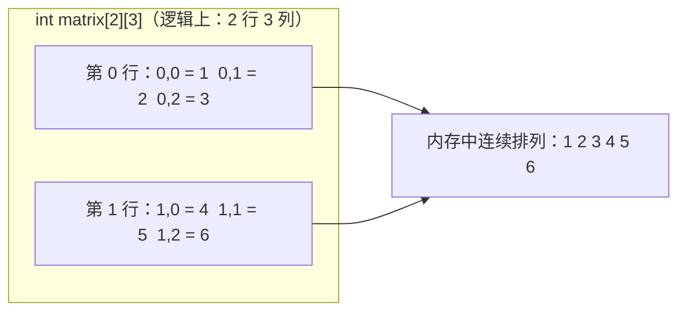

# 3.2 二维数组

3.1 的数组像一条直线：一个下标定位一个元素。但很多数据天生是“表格”：课程表有星期几和第几节课，成绩单有学生和科目，棋盘有行和列。这一节介绍二维数组（two-dimensional array）。

## 3.2.1 声明二维数组

二维数组用两个下标定位元素，可以理解成“行 × 列”的表格：

```c
类型 数组名[行数][列数];
```

```c
int matrix[3][4];    // 3 行 4 列，共 12 个 int
double table[5][3];  // 5 行 3 列，共 15 个 double
```

访问元素时两个下标都要写：

| 表达式 | 含义 |
|--------|------|
| `matrix[0][0]` | 第 0 行第 0 列（左上角） |
| `matrix[1][2]` | 第 1 行第 2 列 |
| `matrix[2][3]` | 第 2 行第 3 列（右下角） |

行、列的下标同样都从 0 开始。`3 行 4 列` 的数组，行下标是 0 到 2，列下标是 0 到 3。

一个常见的心智模型：`int matrix[3][4]` 是“长度为 3 的数组，每个元素又是一个长度为 4 的 int 数组”。

## 3.2.2 初始化二维数组

推荐按行分组初始化，每行用一对大括号：

```c
// 3.2.2 matrix_init.c
#include <stdio.h>

int main(void)
{
	int matrix[2][3] = {
		{1, 2, 3},
		{4, 5, 6}
	};

	for (int row = 0; row < 2; row++) {
		for (int col = 0; col < 3; col++) {
			printf("%d", matrix[row][col]);
			if (col < 2) {
				printf(" ");
			}
		}
		printf("\n");
	}

	return 0;
}
```

<!-- output: 3.2.2 -->
```text
1 2 3
4 5 6
```

外层的每个 `{...}` 对应一行，一眼就能看出哪几个数是同一行。循环里的 `if (col < 2)` 是打印空格分隔的小技巧：最后一个数字后面不再跟空格，输出两边不会有多余的尾巴。

部分初始化的规则和一维一样，没给值的元素自动为 0：

| 写法 | 结果 |
|------|------|
| `int a[2][3] = {{1}, {4}};` | 第 0 行是 `{1, 0, 0}`，第 1 行是 `{4, 0, 0}` |
| `int a[2][3] = {{0}};` | 全部为 0 |
| `int a[][3] = {{1, 2, 3}, {4, 5, 6}};` | 行数省略，编译器数出是 2 |

行数可以省略，**列数不能省略**。原因在 3.2.3：编译器靠列数来计算每个元素的位置。

## 3.2.3 内存布局：其实是一条线

二维数组在内存里并不是“一层一层的表格”，而是**连续存放的一条线**，按行优先（row-major）顺序排列：先放第 0 行的所有元素，再放第 1 行，以此类推。



正因为按行优先排列，编译器才需要知道列数：访问 `matrix[1][2]` 时，它用公式 `行下标 × 列数 + 列下标` 算出这是第几个元素：

| 访问 | 计算 | 实际是第几个 |
|------|------|--------------|
| `matrix[1][2]` | `1 × 3 + 2` = `5` | 第 5 个（从 0 数） |

列数不知道，这个公式就算不出来。这就是“列数不能省”的根本原因，也是 3.5.4 里“二维数组作函数参数必须写明列数”的原因。

## 3.2.4 用宏定义行数和列数

行列数会在循环、初始化等多个地方出现。用一个数字改多处容易漏改，规范做法是用宏（macro）定义常量，第 2 章末尾的规范也建议这样做：

```c
// 3.2.4 matrix_macro.c
#include <stdio.h>

#define ROWS 2
#define COLS 3

int main(void)
{
	int matrix[ROWS][COLS] = {
		{1, 2, 3},
		{4, 5, 6}
	};

	printf("行数是 %zu\n", sizeof(matrix) / sizeof(matrix[0]));
	printf("列数是 %zu\n", sizeof(matrix[0]) / sizeof(matrix[0][0]));

	return 0;
}
```

<!-- output: 3.2.4 -->
```text
行数是 2
列数是 3
```

`sizeof(matrix[0])` 是一行的字节数，除以一个元素的字节数就是列数。这个技巧同样只在定义数组的函数里有效（见 3.1.7）。

## 3.2.5 嵌套循环遍历

遍历二维数组要两层循环：外层走行，内层走列。

```c
// 3.2.5 matrix_traverse.c
#include <stdio.h>

#define ROWS 3
#define COLS 4

int main(void)
{
	int matrix[ROWS][COLS] = {
		{85, 92, 78, 90},
		{65, 88, 95, 72},
		{100, 54, 76, 83}
	};

	for (int row = 0; row < ROWS; row++) {
		for (int col = 0; col < COLS; col++) {
			printf("%4d", matrix[row][col]);
		}
		printf("\n");
	}

	return 0;
}
```

<!-- output: 3.2.5 -->
```text
  85  92  78  90
  65  88  95  72
 100  54  76  83
```

`%4d` 表示每个数占 4 列宽、右对齐，数字长短不一时列仍然对齐。`printf("\n")` 放在外层循环里，每打完一行换一次行——放错层是初学者高频错误。

同样要遵守的模板：

```c
for (int row = 0; row < ROWS; row++) {
	for (int col = 0; col < COLS; col++) {
		/* 用 matrix[row][col] 处理每个元素 */
	}
}
```

两个条件都用 `<`，行下标最大 `ROWS − 1`，列下标最大 `COLS − 1`，不会越界。

## 3.2.6 例：矩阵转置

矩阵转置（transpose）把行变成列、列变成行：`b[j][i] = a[i][j]`。

```c
// 3.2.6 matrix_transpose.c
#include <stdio.h>

#define ROWS 2
#define COLS 3

int main(void)
{
	int a[ROWS][COLS] = {
		{1, 2, 3},
		{4, 5, 6}
	};
	int b[COLS][ROWS];

	for (int i = 0; i < ROWS; i++) {
		for (int j = 0; j < COLS; j++) {
			b[j][i] = a[i][j];
		}
	}

	printf("转置前的 a：\n");
	for (int i = 0; i < ROWS; i++) {
		for (int j = 0; j < COLS; j++) {
			printf("%4d", a[i][j]);
		}
		printf("\n");
	}

	printf("转置后的 b：\n");
	for (int i = 0; i < COLS; i++) {
		for (int j = 0; j < ROWS; j++) {
			printf("%4d", b[i][j]);
		}
		printf("\n");
	}

	return 0;
}
```

<!-- output: 3.2.6 -->
```text
转置前的 a：
   1   2   3
   4   5   6
转置后的 b：
   1   4
   2   5
   3   6
```

注意 `b` 的声明是 `int b[COLS][ROWS]`：2 行 3 列的矩阵转置后是 3 行 2 列。

## 3.2.7 例：按行求和

表格数据的典型用途：每行是一组数据（比如一个学生各科成绩），按行统计。

```c
// 3.2.7 matrix_row_sum.c
#include <stdio.h>

#define ROWS 3
#define COLS 3

int main(void)
{
	int scores[ROWS][COLS] = {
		{85, 92, 78},
		{65, 88, 95},
		{100, 54, 76}
	};

	for (int row = 0; row < ROWS; row++) {
		int sum = 0;
		for (int col = 0; col < COLS; col++) {
			sum += scores[row][col];
		}
		printf("第 %d 行的和是 %d\n", row, sum);
	}

	return 0;
}
```

<!-- output: 3.2.7 -->
```text
第 0 行的和是 255
第 1 行的和是 248
第 2 行的和是 230
```

`int sum = 0;` 必须放在外层循环体内：每换一行，和要重新从 0 累加。如果放在所有循环外面，三行的和会连在一起加。

## 3.2.8 常见错误

最容易踩的一个坑：不分组的初始化写法。

```c
int a[2][3] = {1, 2, 3, 4, 5, 6};
```

这行代码能编译，结果也“碰巧”和分组写法相同——但它的含义是“把 6 个值按内存顺序依次填进这个 2×3 的格子”，一旦个数写错或行数改了，填法就会悄悄错位。对比：

| 写法 | 评价 |
|------|------|
| `int a[2][3] = {{1, 2, 3}, {4, 5, 6}};` | 推荐：按行分组，谁属于哪一行一目了然 |
| `int a[2][3] = {1, 2, 3, 4, 5, 6};` | 合法但易错：靠的是填格子顺序，行数一改就错位 |

其余常见错误：

| 错误写法 | 问题 | 正确写法 |
|----------|------|----------|
| `int a[2][] = {...};` | 列数不能省略 | `int a[][3] = {...};`（行可省，列不可省） |
| `a[2][3] = 1;`（数组是 `int a[2][3]`） | 双重越界 | 行下标最大 `1`，列下标最大 `2` |
| `for (row = 0; row <= ROWS; row++)` | 多跑一行，越界 | `row < ROWS` |
| 内层循环结束后忘了 `printf("\n")`，或放进了内层 | 输出全挤一行 / 每个数换一行 | 换行语句放在外层循环体内 |

## 3.2.9 小结

- 二维数组用两个下标定位元素，行、列下标都从 0 开始。
- 初始化推荐按行分组：`{{1, 2, 3}, {4, 5, 6}}`，行数可省略，列数不可省略。
- 二维数组在内存中按行优先连续存放，编译器靠列数计算元素位置。
- 行数、列数用 `#define` 定义成宏，避免多处写死数字。
- 遍历用两层嵌套循环，换行语句放外层。
- 二维数组作函数参数必须写明列数，这个话题在 3.5.4 展开。

## 练习

1. 声明一个 4 行 5 列的 `double` 数组并全部初始化为 0。
2. `int a[3][4];` 一共有多少个元素？最后一个元素的下标是什么？
3. 下面哪种初始化更好？为什么？

```c
int a[2][3] = {{1, 2, 3}, {4, 5, 6}};
int b[2][3] = {1, 2, 3, 4, 5, 6};
```

4. 为什么 `int a[][3] = {{1, 2, 3}, {4, 5, 6}};` 合法，而 `int a[2][] = {...};` 不合法？
5. 写出下面程序的输出。

```c
int a[2][3] = {{1, 2, 3}, {4, 5, 6}};

printf("%d\n", a[1][0] + a[0][2]);
```

6. 编程题：3 行 4 列的数组如下，求全部元素的平均值，输出格式如下。

```c
int data[3][4] = {
	{10, 20, 30, 40},
	{50, 60, 70, 80},
	{90, 15, 25, 35}
};
```

```text
平均值：43.8
```

7. 编程题：把练习 6 的数组转置后打印出来。

<details>
<summary>参考答案</summary>

1. `double a[4][5] = {{0}};`
2. 12 个元素。最后一个是 `a[2][3]`（行下标最大 `2`，列下标最大 `3`）。
3. 第一种 `a` 更好。按行分组，每行用一对大括号隔开，哪几个数属于一行一目了然；个数写错时错误也更明显。第二种靠内存顺序填格子，行数或个数一改就会错位。
4. 编译器按行优先计算元素位置时需要列数（公式 `行下标 × 列数 + 列下标`）。列数省略，公式没法算；行数可以由初始化列表里的大括号个数数出来。
5. 输出 `7`。`a[1][0]` 是第 1 行第 0 列的 `4`，`a[0][2]` 是第 0 行第 2 列的 `3`，相加得 `7`。

6. 参考代码：

```c
#include <stdio.h>

#define ROWS 3
#define COLS 4

int main(void)
{
	int data[ROWS][COLS] = {
		{10, 20, 30, 40},
		{50, 60, 70, 80},
		{90, 15, 25, 35}
	};
	int sum = 0;

	for (int row = 0; row < ROWS; row++) {
		for (int col = 0; col < COLS; col++) {
			sum += data[row][col];
		}
	}

	printf("平均值：%.1f\n", (double)sum / (ROWS * COLS));

	return 0;
}
```

7. 参考代码：

```c
#include <stdio.h>

#define ROWS 3
#define COLS 4

int main(void)
{
	int data[ROWS][COLS] = {
		{10, 20, 30, 40},
		{50, 60, 70, 80},
		{90, 15, 25, 35}
	};
	int result[COLS][ROWS];

	for (int i = 0; i < ROWS; i++) {
		for (int j = 0; j < COLS; j++) {
			result[j][i] = data[i][j];
		}
	}

	for (int i = 0; i < COLS; i++) {
		for (int j = 0; j < ROWS; j++) {
			printf("%4d", result[i][j]);
		}
		printf("\n");
	}

	return 0;
}
```

</details>

---

[上一节：3.1 数组](<3.1 数组.md>) · [下一节：3.3 字符串基础](<3.3 字符串基础.md>)
