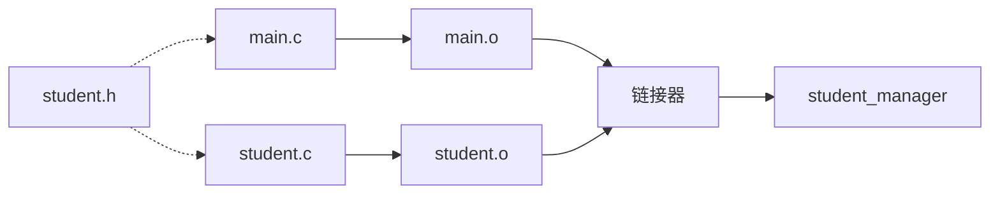

# 4.7 多文件工程与 Makefile

前面的程序都不长，一个 `.c` 文件就能装下。

真实项目通常会变成这样：

- 结构体定义放在头文件里。
- 一组相关函数放在单独的源文件里。
- `main` 只负责串流程。
- 用 Makefile 管理编译和链接。

这一节把“一个文件”拆成“一个工程”。

## 4.7.1 为什么要拆文件

假设你写了一个学生成绩管理程序：

- 学生结构体定义
- 打印学生信息
- 计算平均分
- 读取文件
- 菜单和主流程

如果全部塞进 `main.c`，文件会越来越长，修改一个函数要在一大段代码里找。

拆文件的好处：

可以想象成学校食堂的分工：有人专管洗菜，有人专管掌勺，有人专管收银——各管一摊，出了问题立刻知道找谁。如果一个人从洗菜到收银全包，既累又难查错。`.h` 头文件就像贴在窗口的菜单（告诉你有什么、怎么点），`.c` 源文件才是后厨（具体怎么做）。

| 好处 | 说明 |
|------|------|
| 职责清楚 | 每个文件只负责一类事情 |
| 容易定位 | 改学生逻辑就去 `student.c` |
| 方便复用 | 其他程序也能使用 `student.c` |
| 编译更快 | 只重新编译改动过的文件 |
| 减少冲突 | 多人协作时不容易改到同一个文件 |

## 4.7.2 先看一个单文件版本

为了对比，先看一个能运行的单文件程序：

```c
// 4.7.1 student_manager_single.c
#include <stdio.h>

#define MAX_NAME 32
#define STUDENT_COUNT 2

struct student {
	char name[MAX_NAME];
	int age;
	double score;
};

void print_student(const struct student *student)
{
	printf("%s，%d 岁，%.1f 分\n",
	       student->name, student->age, student->score);
}

double average_score(const struct student students[], int count)
{
	double sum = 0.0;

	for (int i = 0; i < count; i++) {
		sum += students[i].score;
	}

	if (count == 0) {
		return 0.0;
	}
	return sum / count;
}

int main(void)
{
	struct student students[STUDENT_COUNT] = {
		{"小明", 20, 88.5},
		{"小红", 19, 92.0},
	};
	double average = average_score(students, STUDENT_COUNT);

	for (int i = 0; i < STUDENT_COUNT; i++) {
		print_student(&students[i]);
	}

	printf("平均分：%.1f\n", average);

	return 0;
}
```

<!-- output: 4.7.1 -->
```text
小明，20 岁，88.5 分
小红，19 岁，92.0 分
平均分：90.2
```

这个版本逻辑清楚，但所有东西都在一个文件里。接下来把它拆成三个文件：

```text
student.h     结构体定义和函数声明
student.c     函数实现
main.c        程序入口
Makefile      编译规则
```

## 4.7.3 头文件：放声明

`student.h` 只放“别人需要知道的东西”：

- 结构体定义
- 常量
- 函数声明

```c
// student.h
#ifndef STUDENT_H
#define STUDENT_H

#define MAX_NAME 32

struct student {
	char name[MAX_NAME];
	int age;
	double score;
};

void print_student(const struct student *student);
double average_score(const struct student students[], int count);

#endif
```

### 头文件卫士

`#ifndef STUDENT_H`、`#define STUDENT_H`、`#endif` 叫头文件卫士，也叫 include guard。

头文件卫士就像食堂餐盘上盖的“已消毒”标签：盘子第一次消毒后贴上标签；再次端过来时，看到标签就直接跳过，不再消毒一遍——防止重复劳动（重复定义）。

它的作用是防止同一个头文件被重复包含。例如：

```c
#include "student.h"
#include "student.h"
```

第二次包含时，`STUDENT_H` 已经定义，预处理器会跳过内容，避免结构体被重复定义。

头文件里通常不要放函数定义。函数定义放到 `.c` 文件里，头文件只放声明。否则多个源文件包含同一个头文件时，容易出现“重复定义”的链接错误。

## 4.7.4 源文件：放实现

`student.c` 包含头文件，然后写函数实现：

```c
// student.c
#include <stdio.h>
#include "student.h"

void print_student(const struct student *student)
{
	printf("%s，%d 岁，%.1f 分\n",
	       student->name, student->age, student->score);
}

double average_score(const struct student students[], int count)
{
	double sum = 0.0;

	for (int i = 0; i < count; i++) {
		sum += students[i].score;
	}

	if (count == 0) {
		return 0.0;
	}
	return sum / count;
}
```

注意：

- 自己写的头文件用双引号：`#include "student.h"`。
- 标准库头文件用尖括号：`#include <stdio.h>`。
- 双引号通常先在当前目录找，尖括号通常去系统目录找。

## 4.7.5 main.c：只负责串流程

```c
// main.c（关键部分）
#include <stdio.h>
#include "student.h"

int main(void)
{
	struct student students[] = {
		{"小明", 20, 88.5},
		{"小红", 19, 92.0},
	};
	int count = (int)(sizeof(students) / sizeof(students[0]));

	for (int i = 0; i < count; i++) {
		print_student(&students[i]);
	}

	printf("平均分：%.1f\n", average_score(students, count));

	return 0;
}
```

`sizeof(students) / sizeof(students[0])` 计算数组元素个数。这里只适用于真正的数组，不适用于指针，后面会再解释。

`main.c` 不关心平均分怎么算，也不关心学生信息怎么打印。它只负责准备数据、调用函数、输出结果。

## 4.7.6 编译和链接

多文件项目的构建分两步：

1. 把每个 `.c` 文件编译成目标文件 `.o`。
2. 把所有目标文件链接成可执行文件。

这两步可以类比成把一篇合著的书稿出版：第一步，每位作者各自把自己负责的章节排好版（编译成 `.o`）；第二步，印刷厂把所有章节按目录顺序装订成册、补上互相引用的页码（链接）。某个作者改了稿子，只需要重排他那几章，其余章节不动——这正是 Make 省时间的道理。



可以手动执行：

```bash
cc -std=c11 -Wall -Wextra -Werror -pedantic -c main.c -o main.o
cc -std=c11 -Wall -Wextra -Werror -pedantic -c student.c -o student.o
cc main.o student.o -o student_manager
./student_manager
```

`-c` 表示只编译，不链接。最后一步才把目标文件链接成可执行文件。

手动写这些命令很麻烦，文件一多更容易漏。于是需要 Makefile。

## 4.7.7 写一个 Makefile

```make
CC ?= cc
CFLAGS ?= -std=c11 -Wall -Wextra -Werror -pedantic
TARGET := student_manager
OBJS := main.o student.o

all: $(TARGET)

$(TARGET): $(OBJS)
	$(CC) $(CFLAGS) -o $@ $^

%.o: %.c student.h
	$(CC) $(CFLAGS) -c $< -o $@

clean:
	rm -f $(TARGET) $(OBJS)

.PHONY: all clean
```

几个关键点：

- `CC ?= cc`：如果没有指定编译器，就用 `cc`。
- `CFLAGS ?=`：编译选项。`-Wall -Wextra` 打开警告，`-Werror` 把警告当成错误。
- `TARGET`：最终生成的可执行文件名。
- `OBJS`：需要链接的目标文件。
- `all: $(TARGET)`：默认目标。
- `$(TARGET): $(OBJS)`：可执行文件依赖两个 `.o`。
- `%.o: %.c student.h`：每个 `.o` 由对应的 `.c` 生成，同时依赖 `student.h`。
- `$@`：当前目标名。
- `$^`：所有依赖文件。
- `$<`：第一个依赖文件。
- `clean`：删除生成物。
- `.PHONY`：告诉 Make，`all` 和 `clean` 不是真实文件。

> **重要**
>
> Makefile 的缩进必须用 Tab，不能用空格。很多“missing separator”错误都是因为用了空格。

## 4.7.8 使用 Make

在项目目录下执行：

```bash
make
```

它会自动编译需要更新的文件，然后链接。

把 Make 想成食堂值班经理：他盯着一张“谁依赖谁”的清单，只重做被动过食材的那几道菜，没动过的直接端上桌。你改了 `student.c`，它只重编译这一个文件；改了 `student.h`，依赖它的两个文件都得重做——清单上写得明明白白。

运行：

```bash
./student_manager
```

清理：

```bash
make clean
```

只重新编译：

```bash
make clean
make
```

修改 `student.c` 后再次 `make`，通常只会重新编译 `student.c`，然后重新链接。这就是 Make 根据依赖关系工作的结果。

## 4.7.9 Windows 下怎么办

Windows 原生环境通常没有 `make`。如果使用 MinGW/MSYS2，常见命令是：

```bat
mingw32-make
student_manager.exe
mingw32-make clean
```

也可以安装 MSYS2 的 `make`，然后在 MSYS2 终端里直接使用 `make`。

> **Windows 提示**
>
> 如果提示 `make` 不是内部或外部命令，先确认 MinGW/MSYS2 的 `bin` 目录已经加入 `PATH`。Windows 上可执行文件通常带 `.exe`，运行时写 `.\student_manager.exe` 或 `student_manager.exe`。

## 4.7.10 常见错误

### undefined reference to ...

链接时找不到函数定义。常见原因：

- 忘记把 `student.c` 加入编译。
- 函数只有声明，没有实现。
- 函数名拼写不一致。
- 忘记链接某个库。

### multiple definition of ...

同一个函数或全局变量被定义了多次。常见原因：

- 在头文件里写了函数定义，多个 `.c` 都包含了它。
- 两个源文件定义了同名全局变量。

### student.h: No such file or directory

编译器找不到头文件。检查：

- 头文件是否和源文件在同一目录。
- `#include "student.h"` 的路径是否正确。
- 编译时是否需要 `-I` 指定目录。

### missing separator

Makefile 的规则行用了空格缩进。命令必须以 Tab 开头。

### 修改头文件后没有重新编译

如果 Makefile 的依赖没有写 `student.h`，修改结构体后可能只有部分文件重新编译，导致目标文件布局不一致。上面的 `%.o: %.c student.h` 就是为了避免这个问题。

## 4.7.11 可直接套用的 Makefile 模板

换一个项目时，Makefile 的骨架其实不用重写。下面两个模板可以直接改名字拿去用。

单文件项目：

```make
CC ?= cc
CFLAGS ?= -std=c11 -Wall -Wextra -pedantic
TARGET := demo

all: $(TARGET)

$(TARGET): $(TARGET).c
	$(CC) $(CFLAGS) $< -o $@

clean:
	rm -f $(TARGET)

.PHONY: all clean
```

把 `demo` 改成你的程序名，`make` 编译，`make clean` 清理。

多文件项目。每新增一个源文件，只需要在 `OBJS` 里加一个对应的 `.o`：

```make
CC ?= cc
CFLAGS ?= -std=c11 -Wall -Wextra -pedantic
TARGET := app
OBJS := main.o tools.o utils.o

all: $(TARGET)

$(TARGET): $(OBJS)
	$(CC) $(CFLAGS) $^ -o $@

%.o: %.c
	$(CC) $(CFLAGS) -c $< -o $@

clean:
	rm -f $(TARGET) $(OBJS)

.PHONY: all clean
```

这里出现了模式规则 `%.o: %.c`：任意的 `.o` 都由同名的 `.c` 编译而来，一条规则覆盖所有源文件。4.7.7 的例子写成 `%.o: %.c student.h`，是在这条通用规则上补上头文件依赖。

三个自动变量在模板里的分工值得再确认一遍：

| 自动变量 | 在这条规则里的值 | 用在哪 |
|----------|------------------|--------|
| `$@` | 当前目标名 | 链接时是 `app`，编译时是某个 `.o` |
| `$^` | 所有依赖 | 链接时是全部 `.o` |
| `$<` | 第一个依赖 | 编译时是对应的 `.c` 文件 |

模板里命令行的 `$@`、`$^`、`$<` 让规则“模板化”，不需要为每个文件重复写名字。

## 4.7.12 小结

- 头文件放声明、结构体和常量，源文件放实现。
- 自己写的头文件用双引号包含。
- 头文件卫士防止重复包含。
- 多文件构建分“编译成目标文件”和“链接成可执行文件”两步。
- Makefile 用依赖关系决定编译顺序，避免每次全量编译。
- Makefile 的命令行必须以 Tab 开头。
- 换项目时可以直接套用模板，新增源文件只需在 `OBJS` 里加一项。
- Windows 下常用 `mingw32-make`，注意 `.exe` 和 `PATH`。

## 练习

### 一、选择题

**1. 头文件（`.h`）和源文件（`.c`）的分工是：**

A. 头文件放声明、结构体和常量，源文件放函数实现\
B. 头文件放函数实现，源文件放声明\
C. 两者随便放\
D. 头文件只能放宏定义

**2. 包含自己写的 `student.h`，正确的写法是：**

A. `#include <student.h>`\
B. `#include "student.h"`\
C. `#include student.h`\
D. `import student.h;`

**3. Makefile 中命令行（配方）必须以什么开头？**

A. 空格\
B. Tab\
C. 分号\
D. `#`

### 二、填空题

**4. 头文件卫士的三件套是 `#ifndef`、`#define` 和 `_______`，作用是防止头文件被_______包含。**

**5. 链接时报 `undefined reference to 'average_score'`，常见原因是 `student.c` 没有参与_______，或函数只有_______没有实现。**

### 三、改错题

**6. 下面的程序想模拟“一个声明、一个实现、一个调用”的结构（全部写在一个文件里以便演示），其中有 3 个错误，请找出并改正：**

```c
#include <stdio.h>

void print_score(char name[], double score);

struct point {
	int x;
	int y
};

int main(void)
{
	struct point p = {3, 4};

	print_score("小明", 92.5);

	printf("点：(%d, %d)\n", p.x, p.y)

	return 0;
}

void print_score(char name, double score)
{
	printf("%s 的成绩：%.1f\n", name, score);
}
```

### 四、编程题

**7. 按多文件工程的分工，写出下面三个文件的完整内容：`math_utils.h`（声明 `double average(double a, double b);` 和头文件卫士）、`math_utils.c`（实现：返回两数平均值）、`main.c`（调用它输出 `平均值：3.5`，用 `average(3.0, 4.0)` 验证）。并写出手工编译三个文件的 `cc` 命令。**

**8. 为上面的工程写一个 Makefile：定义变量 `CC`、`CFLAGS`，目标 `student_manager` 由 `main.o` 和 `math_utils.o` 链接而成，写清 `%.o: %.c` 的模式规则（命令行用 Tab 开头），再补上 `clean` 目标。**

### 五、思考题

**9. 思考：程序会算、会分叉、会重复、会打包数据了，但程序一结束，内存里的数据就全没了。**

请思考：

1. 辛苦录入的通讯录、算出来的成绩，怎么才能在程序关闭后还留着？
2. 你平时用的软件把“数据”放在哪里？程序和磁盘之间需要一个什么样的“通道”？
3. 猜猜 C 语言里读写文件的第一步是什么？（提示：像 `fopen` 这样的函数返回一个“门牌号”。）

提示：下一章我们将学习文件读写与实战——`fopen`、`fprintf`、`fgets`，把数据保存到磁盘上。

<details>
<summary>参考答案</summary>

#### 一、选择题

1. **A**。声明给别人看，实现放源文件，这是多文件工程的基本分工。
2. **B**。自己的头文件用双引号（先在项目目录找）；尖括号留给系统头文件。
3. **B**。命令行必须以 Tab 开头，用空格缩进会报 `missing separator`。
4. `#endif`；重复。
5. 编译（或链接）；声明。

#### 三、改错题

三处错误：

1. `struct point` 定义里 `int y` 行尾漏了分号（成员声明的分号不能省）。
2. `printf("点：(%d, %d)\n", p.x, p.y)`：行尾漏了分号。
3. `void print_score(char name, double score)`：定义的参数和声明的 `char name[]` 不一致——`char` 只能装一个字符，`"小明"` 是字符串。定义应与声明保持一致，写成 `char name[]`。

修正后的完整程序（输出 `小明 的成绩：92.5` 和 `点：(3, 4)`）：

```c
#include <stdio.h>

struct point {
	int x;
	int y;
};

void print_score(char name[], double score);

int main(void)
{
	struct point p = {3, 4};

	print_score("小明", 92.5);

	printf("点：(%d, %d)\n", p.x, p.y);

	return 0;
}

void print_score(char name[], double score)
{
	printf("%s 的成绩：%.1f\n", name, score);
}
```

#### 四、编程题

7. 参考代码。

`math_utils.h`：

```c
#ifndef MATH_UTILS_H
#define MATH_UTILS_H

double average(double a, double b);

#endif
```

`math_utils.c`：

```c
#include "math_utils.h"

double average(double a, double b)
{
	return (a + b) / 2.0;
}
```

`main.c`：

```c
#include <stdio.h>
#include "math_utils.h"

int main(void)
{
	printf("平均值：%.1f\n", average(3.0, 4.0));

	return 0;
}
```

编译命令：

```text
cc -std=c11 -Wall -Wextra -pedantic main.c math_utils.c -o average_demo
```

8. 参考 Makefile：

```text
CC = cc
CFLAGS = -std=c11 -Wall -Wextra -pedantic

student_manager: main.o math_utils.o
	$(CC) main.o math_utils.o -o student_manager

%.o: %.c math_utils.h
	$(CC) $(CFLAGS) -c $< -o $@

clean:
	rm -f *.o student_manager
```

说明：链接规则里 `$@` 可代替 `student_manager`、`$^` 可代替 `main.o math_utils.o`；模式规则里 `$<` 是第一个依赖（`.c` 文件）。所有命令行以 Tab 开头。

#### 五、思考题

9. 开放回答，供参考：

1. 把数据写到磁盘文件里——程序结束文件还在，下次运行再读回来。
2. 放在文件（如配置文件、存档、数据库文件）里。程序和磁盘之间需要一套“打开文件、读写、关闭”的系统接口。
3. 调用打开文件的函数，拿到一个代表这个文件的指针（`FILE *`），之后的读写都凭这个指针进行。第 5 章就从 `fopen` 讲起。

<details>
<summary>参考答案</summary>

1. 多个源文件都需要知道 `struct student` 的布局；放在头文件里可以统一包含，避免每个 `.c` 重复定义。
2. 防止同一个头文件被重复包含，导致结构体或宏重复定义。
3. 双引号通常先在当前目录或指定目录查找，适合项目自己的头文件；尖括号通常去系统头文件目录查找，适合标准库。

#### 二、填空题

4. `$@` 是目标文件，`$^` 是所有依赖文件，`$<` 是第一个依赖文件。
5. 可能是 `student.c` 没有参与编译或链接，或者函数名拼写不一致，或者只有声明没有实现。

</details>

---

[上一节：4.6 const 与多级指针](<4.6 const 与多级指针.md>) · [下一节：第 5 章 文件读写与实战](../../chapter5/README.md)
